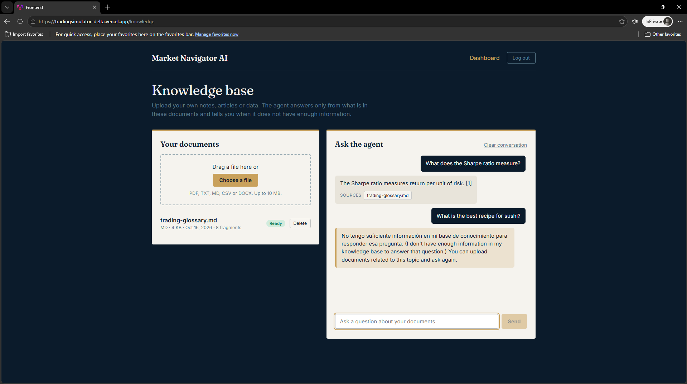
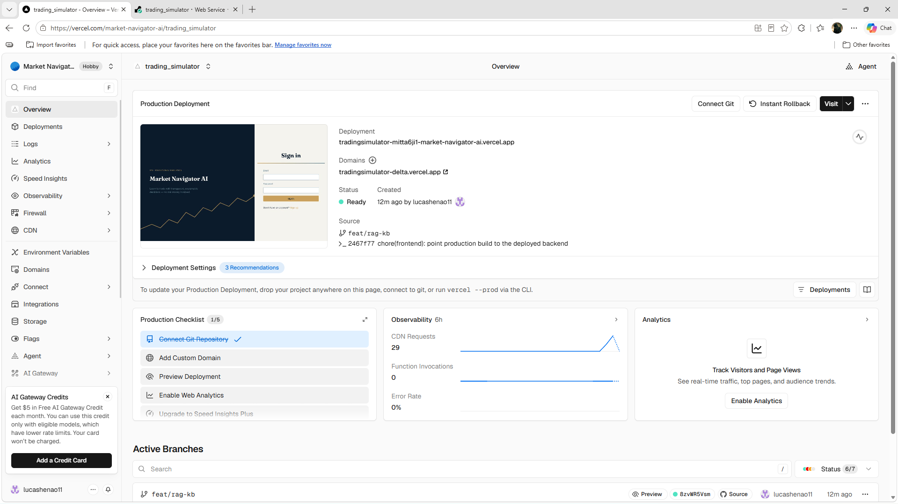
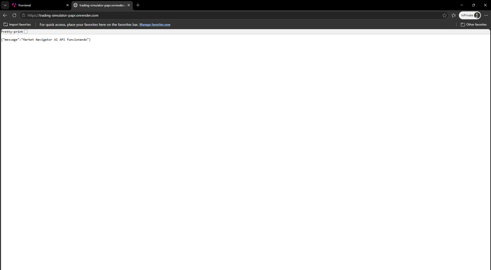
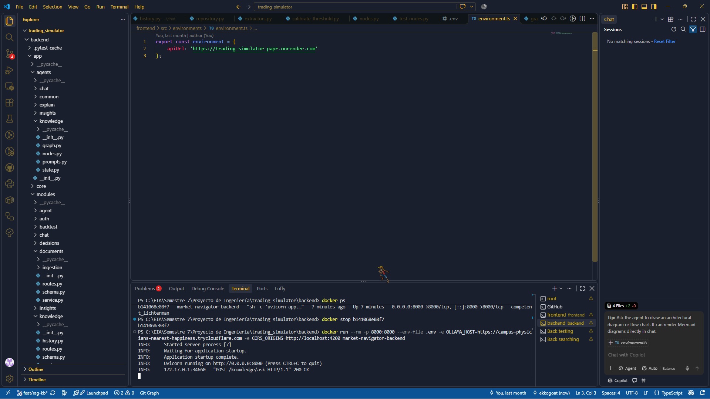
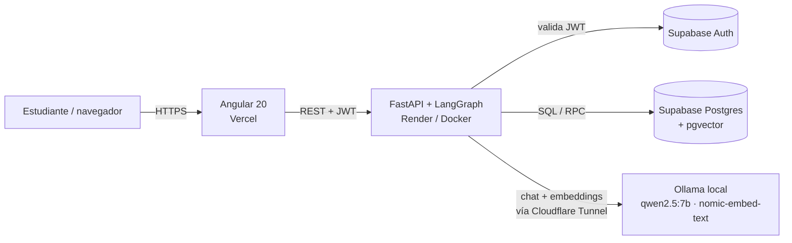
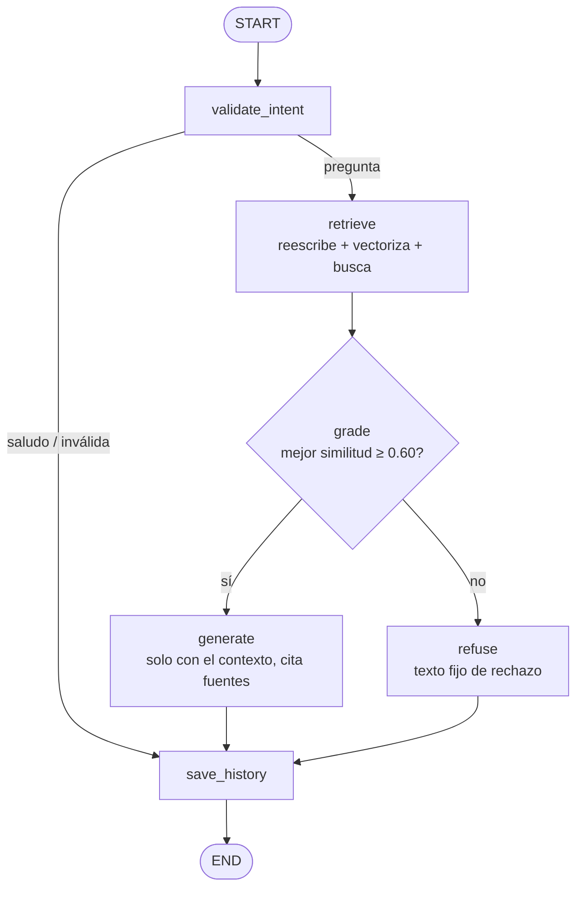
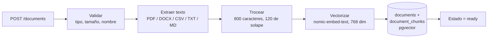

# Market Navigator AI

Plataforma educativa de apoyo a la decisión en trading. Los estudiantes simulan estrategias sobre datos históricos del S&P 500, entienden por qué una posición se abriría, se mantendría o se rechazaría, y consultan a un **agente con RAG que responde solo con los documentos que ellos suben**. No se usa dinero real.

> **Trabajo Agente (LangChain + LangGraph + RAG).** El módulo evaluado es el *agente de conocimiento*: sube un documento, pregunta, recibe una respuesta con fuentes, o un rechazo explícito si la información no está en tu base de conocimiento.

## Despliegue en producción

| Pieza | Plataforma | URL |
|-------|-----------|-----|
| Frontend | Vercel | https://tradingsimulator-delta.vercel.app |
| Backend (API) | Render (Docker) | https://trading-simulator-papr.onrender.com |
| Documentación de la API | Render | https://trading-simulator-papr.onrender.com/docs |
| Modelo local (Ollama) | Equipo propio + Cloudflare Tunnel | URL temporal `*.trycloudflare.com` |
| Base de datos y Auth | Supabase | Proyecto administrado |

> **Antes de probar la demo:** el modelo de lenguaje corre en un equipo propio (requisito: modelo local). Si el equipo con Ollama y el túnel están apagados, el agente responde `503`. Además, el plan gratuito de Render duerme el servicio tras ~15 min sin tráfico: abre la URL del backend un minuto antes y espera a que responda `{"message": "Market Navigator AI API funcionando"}`.

### Capturas

| Agente en producción: respuesta con fuente y rechazo | Despliegue en Vercel |
|---|---|
|  |  |

| Backend en Render | Backend en Docker |
|---|---|
|  |  |

## Qué incluye

- **Motor de backtesting** con SMA, RSI, Bandas de Bollinger, Momentum y un ensamble ponderado por régimen, con una capa de riesgo obligatoria (stop-loss, tamaño de posición, drawdown máximo).
- **Resultados:** métricas (Sharpe, drawdown, win rate, profit factor), curva de capital, comparación con *buy & hold* y registro completo de decisiones.
- **Agentes con LangChain + LangGraph y modelo local (Ollama):**
  - **Conocimiento (RAG):** sube PDF, DOCX, TXT, MD o CSV; el agente responde solo desde ellos, cita sus fuentes y se niega cuando no sabe.
  - *Explain:* agente con herramientas que explica una decisión a partir de datos registrados.
  - *Chat guiado:* enrutador, memoria persistente, respuestas en streaming (SSE).
  - *Insights:* hallazgos generados automáticamente al terminar una simulación.
- **Autenticación** con Supabase Auth (JWT). Todos los endpoints, excepto registro y login, exigen un token válido.

## Arquitectura




Cómo funcionan los 8 agentes (qué inicia cada uno, sus nodos y las herramientas que usa cada nodo): **[docs/agents.md](docs/agents.md)**.


### Grafo del agente de conocimiento (LangGraph)



### Ingesta de documentos



Más detalle en [docs/architecture.md](docs/architecture.md). El informe técnico completo está en [docs/informe-tecnico.pdf](docs/informe-tecnico.pdf).

## Tecnologías

| Capa | Tecnología |
|------|-----------|
| Frontend | Angular 20 (componentes standalone, signals) |
| Backend | FastAPI, Python 3.12 |
| Agentes | LangChain, LangGraph |
| LLM local | Ollama: `qwen2.5:7b` (chat) y `nomic-embed-text` (embeddings, 768 dimensiones) |
| Base de datos + vectores | Supabase Postgres con pgvector (índice HNSW, distancia coseno) |
| Autenticación | Supabase Auth (JWT) |
| Despliegue | Docker, Render, Vercel, Cloudflare Tunnel |

**Por qué estos modelos locales.** `qwen2.5:7b` ofrece llamada a herramientas fiable y respuestas multilingües en un tamaño que corre en un portátil con 8 GB de RAM; es menos obediente que un modelo alojado, por eso el agente verifica su salida. `nomic-embed-text` pesa 274 MB y recupera bien para su tamaño. No se usa ninguna API comercial de IA.

## Control de alucinaciones

El agente prefiere callar a inventar. Cinco controles, en capas:

1. **Umbral de similitud** en la recuperación (`RETRIEVAL_THRESHOLD = 0.45`).
2. **Nodo de suficiencia** (`grade`): si el mejor fragmento no llega a `0.60`, rechaza sin generar respuesta.
3. **Prompt restringido al contexto**: solo los pasajes numerados, cita `[n]`, prohibido inventar analogías; si no está la respuesta, el modelo emite `INSUFFICIENT_CONTEXT`.
4. **Rechazo explícito con texto fijo:** *"No tengo suficiente información en mi base de conocimiento para responder esa pregunta."*
5. **Fuentes visibles** (archivo, fragmento, similitud) en cada respuesta.

Además: filtro de intención (preguntas vacías, demasiado largas, intentos de inyección y saludos), reescritura de la consulta de búsqueda a inglés sin tono ni audiencia, y retiro de las peticiones de estilo ("como si tuviera cinco años") antes de generar.

### Evaluación (20 preguntas, sin ajustar umbrales a los resultados)

| Resultado | Valor |
|-----------|-------|
| Comportamiento correcto | **19 / 20** |
| Respondió lo que debía rechazar (alucinación) | **0 / 10** |
| Rechazó lo que podía responder (falso rechazo) | 1 / 10 (*walk-forward*, similitud 0.573) |

Tabla completa en [docs/evaluation/hallucination_results.md](docs/evaluation/hallucination_results.md). Para reproducirla (con Ollama activo y `docs/knowledge/trading-glossary.md` cargado):

```powershell
cd backend
.\venv\Scripts\python -m scripts.evaluate_knowledge <tu_user_id>
```

## Ejecutar en local

### Requisitos
Python 3.12, Node 22, [Ollama](https://ollama.com) y un proyecto de Supabase.

### 1. Modelos
```bash
ollama pull qwen2.5:7b
ollama pull nomic-embed-text
```

### 2. Base de datos
En el editor SQL de Supabase ejecuta, en orden, los archivos de `backend/migrations/` (`001_` a `004_`). El `003_` activa `pgvector` y crea las tablas `documents` y `document_chunks`.

### 3. Backend
```powershell
cd backend
python -m venv venv
.\venv\Scripts\Activate.ps1
pip install -r requirements.txt
copy ..\.env.example .env      # y completa los valores
uvicorn app.main:app --reload
```
API y Swagger: http://localhost:8000/docs

### 4. Frontend
```powershell
cd frontend
npm ci
ng serve
```
Aplicación: http://localhost:4200 (en desarrollo usa `http://localhost:8000` como API).

### 5. Probar el agente
1. Regístrate e inicia sesión.
2. Abre **Knowledge** y sube `docs/knowledge/trading-glossary.md`; espera el estado *Ready*.
3. Pregunta *"What does the Sharpe ratio measure?"* → respuesta con fuente.
4. Pregunta *"What is the best recipe for sushi?"* → rechazo con el texto fijo.

### Todo con Docker Compose
```bash
cp .env.example backend/.env   # completa los valores
docker compose up --build
docker compose exec ollama ollama pull qwen2.5:7b
docker compose exec ollama ollama pull nomic-embed-text
```

### Solo el backend en un contenedor
```bash
docker build -t market-navigator-backend ./backend
docker run --rm -p 8000:8000 --env-file backend/.env \
  -e OLLAMA_HOST=http://host.docker.internal:11434 \
  -e CORS_ORIGINS=http://localhost:4200 market-navigator-backend
```

## Variables de entorno (backend)

Copia `.env.example` a `backend/.env`. **Nunca** subas el `.env` real.

| Variable | Descripción |
|----------|-------------|
| `SUPABASE_URL` | URL del proyecto de Supabase |
| `SUPABASE_KEY` | Clave pública (anon / publishable) |
| `SUPABASE_SECRET_KEY` | Clave secreta (service role). Solo en el backend |
| `SUPABASE_DB_URL` | Conexión directa a Postgres (pooler de sesión), usada por los checkpoints de LangGraph |
| `OLLAMA_HOST` | URL de Ollama. Local: `http://localhost:11434`. Producción: URL del túnel |
| `CORS_ORIGINS` | Orígenes permitidos separados por coma. Producción: `https://tradingsimulator-delta.vercel.app,http://localhost:4200` |

El frontend no usa variables de entorno: la URL de la API está en `frontend/src/environments/environment.ts` (producción) y `environment.development.ts` (local).

## Despliegue

### 1. Ollama público (Cloudflare Tunnel)
Con Ollama en ejecución y los dos modelos descargados:
```bash
cloudflared tunnel --url http://localhost:11434 --http-host-header localhost:11434
```
Copia la URL `https://….trycloudflare.com` que imprime y verifica que `<url>/api/tags` responde. El encabezado `Host` se reescribe porque Ollama rechaza hosts desconocidos. La terminal debe quedar abierta; si se reinicia, la URL cambia y hay que actualizar `OLLAMA_HOST` en Render.

### 2. Backend en Render
Nuevo *Web Service* desde el repositorio:

| Campo | Valor |
|-------|-------|
| Language / Runtime | Docker |
| Root Directory | `backend` |
| Branch | `feat/rag-kb` (o `main` tras el *merge*) |
| Instance type | Free |
| Environment | las seis variables de la tabla anterior |

Render inyecta `$PORT`, que el `Dockerfile` ya respeta. Comprueba la raíz de la URL pública.

### 3. Frontend en Vercel
Con `environment.ts` apuntando al backend de Render:
```powershell
cd frontend
npx vercel --prod
```
`frontend/vercel.json` define el comando de build, la carpeta de salida (`dist/frontend/browser`) y la reescritura a `index.html` para las rutas de la SPA. En el proyecto de Vercel, *Deployment Protection* debe estar desactivada para el acceso público. Vercel no se redespliega solo al hacer *push*: repite `npx vercel --prod` tras cada cambio de frontend.

### 4. CORS
Añade el dominio de Vercel a `CORS_ORIGINS` en Render.

## API (endpoints principales)

| Método | Ruta | Descripción |
|--------|------|-------------|
| POST | `/users/` | Registro |
| POST | `/auth/login` | Login; devuelve el JWT |
| GET | `/auth/me` | Usuario actual |
| POST | `/documents` | Subir un documento a la base de conocimiento |
| GET | `/documents` | Listar mis documentos |
| DELETE | `/documents/{id}` | Borrar un documento y sus fragmentos |
| POST | `/knowledge/ask` | Preguntar al agente de conocimiento |
| GET / DELETE | `/knowledge/history` | Historial de la conversación |
| POST | `/simulations/start` | Ejecutar una simulación |
| POST | `/simulations/{id}/chat/stream` | Chat guiado (SSE) |

Lista completa en `/docs` (Swagger).

## Pruebas
```powershell
cd backend ; .\venv\Scripts\python -m pytest -q
cd frontend ; ng test --watch=false
```
Las pruebas del agente usan modelos falsos inyectados, por lo que corren sin Ollama ni Supabase.

## Estructura del repositorio

```
backend/    FastAPI (app/), tests/, migrations/, scripts/, Dockerfile
  app/agents/knowledge/   grafo LangGraph del agente RAG (graph, nodes, prompts, state)
  app/modules/documents/  subida e ingesta de documentos
  app/vectorstore/        embeddings y repositorio pgvector
frontend/   Angular (src/app/{core,features,shared,models})
docs/       architecture.md, evaluation/, knowledge/, screenshots/, informe técnico
docker-compose.yml   .env.example
```

## Limitaciones conocidas

- Un único umbral de similitud solapa algunos casos límite: *walk-forward* (0.573) se rechaza por error; *Kelly* (0.593) y *Black-Scholes* (0.588) quedan cerca del piso y los detiene el generador.
- Las preguntas en español puntúan entre 0.05 y 0.10 menos contra documentos en inglés; la reescritura a inglés lo compensa en parte.
- El verificador LLM de suficiencia está desactivado (`USE_LLM_GRADER = False`): el modelo de 7B rechazó 2 de 3 preguntas válidas. El código se conserva.
- La detección de peticiones de estilo usa expresiones regulares y no cubre toda formulación posible.
- El túnel de Cloudflare es público y sin autenticación mientras esté abierto; la demo depende de que el equipo con Ollama esté encendido.
- Render (plan Free) tarda ~1 minuto en despertar.

## Equipo

Lucas Henao, Santiago Cardozo y Luciano Jaramillo. Universidad EIA, Ingeniería de Sistemas, semestre 7.
