# How the agents work

Market Navigator AI has **8 LangGraph graphs**, all in `backend/app/agents/<name>/graph.py`. They share one local model (`agents/common/llm.py`: Ollama `qwen2.5:7b`, temperature 0, 60 s timeout); the knowledge agent also uses `nomic-embed-text` for embeddings.

The diagrams below are drawn by hand from the graphs exported from the code (`docs/agents/graphs/*.mmd`, see [How to regenerate](#4-how-to-regenerate)). If a diagram and the code disagree, the code is right.

| Agent | Story | Flow | Started by |
|---|---|---|---|
| [explain](#explain-us-20) | US-20 | `agent ⇄ tools` (ReAct) | Explain button, chat `explain_agent` |
| [chat](#chat-us-2225) | US-22/25 | `supervisor` → one route | Question in guided mode |
| [insights](#insights-us-26) | US-26 | `gather_facts → explain → verify` | A simulation finishes |
| [compare](#compare-us-27) | US-27 | `fetch_a ∥ fetch_b → diff → explain → verify` | Compare in History, chat, what-if |
| [report](#report-us-32) | US-32 | `gather_facts → write → verify` | Generate report |
| [setup](#setup-us-29) | US-29 | `extract → validate → ask_missing \| propose` | Describe your simulation |
| [what-if](#what-if-us-28) | US-28 | `load → copy → run → compare \| fallback` | Run what-if (after confirming) |
| [knowledge](#knowledge-us-30) | US-30 | `validate_intent → retrieve → grade → generate \| refuse → save_history` | Knowledge question |

---

## 1. Overview

Each entry point starts one graph. Some graphs reuse others, and two steps wait for the student before anything runs or is saved.

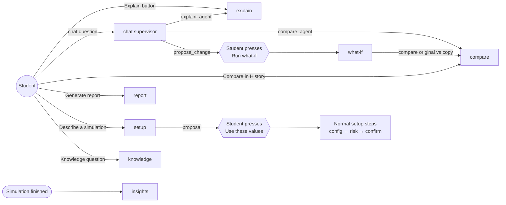

---

## 2. One diagram per agent

Solid arrows are the graph edges; dashed lines connect a node to the tools and data it uses. Conditional edges carry their condition as the label.

### explain (US-20)

ReAct loop: the model decides which tools to call, LangGraph runs them and gives the results back, until the model answers without tool calls (`tools_condition`). Builder: `build_agent_graph(simulation_id, user_id)`; the tools are bound to that simulation.

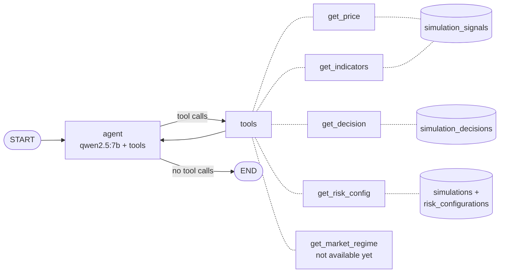

### chat (US-22/25)

The `supervisor` asks the router model for a route as JSON (`routing/router.py`); Python validates it and resolves dates, risk proposals and the simulation to compare with. `propose_change` and `clarify` answer directly from the supervisor and end the turn.

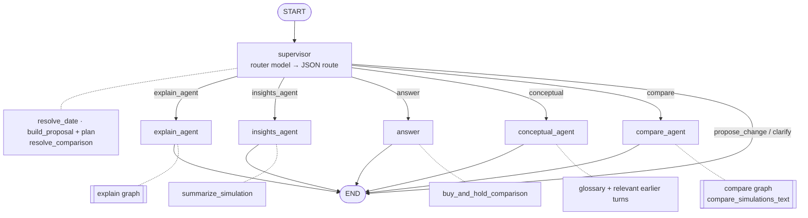

The conversation is stored by a Postgres checkpointer (`modules/chat/checkpointer.py`, in-memory if `SUPABASE_DB_URL` is not set) and in `chat_messages`; `conceptual_agent` only sees the earlier turns relevant to the new question (`modules/chat/memory.py`). `propose_change` returns the proposal and its plan; it never changes anything (see what-if).

### insights (US-26)

Started by the backend, not by a question, when a simulation reaches `FINISHED` or `STOPPED_BY_RISK`. The highlights are computed by code; the model only explains each one.

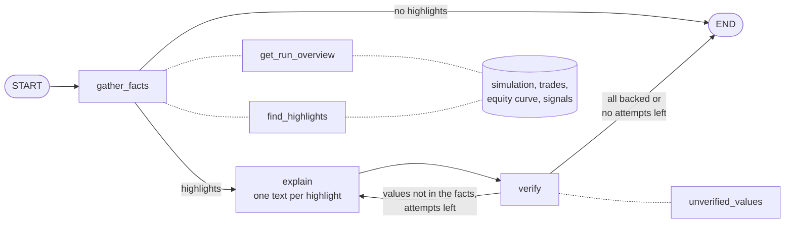

`modules/insights/service.py` stores the verified texts in `simulation_insights`.

### compare (US-27)

Both simulations are fetched in parallel through tools bound to the student. Only a slice of each run is read, never its daily data.

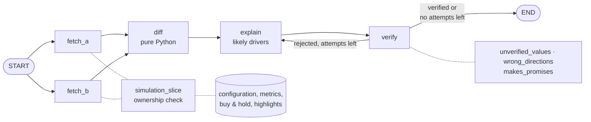

`diff` computes the configuration differences, the metric deltas, which run is better in each metric and the winner by total return. `verify` also rejects text that names the wrong run as the larger or smaller one. The `list_simulations` tool is used by the chat supervisor to resolve "my previous one".

### report (US-32)

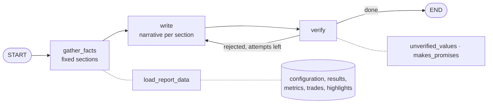

The tables, figures and the disclaimer are written by code (`agents/report/facts.py`, `render.py`); a narrative that fails twice is dropped and the section keeps only its figures.

### setup (US-29)

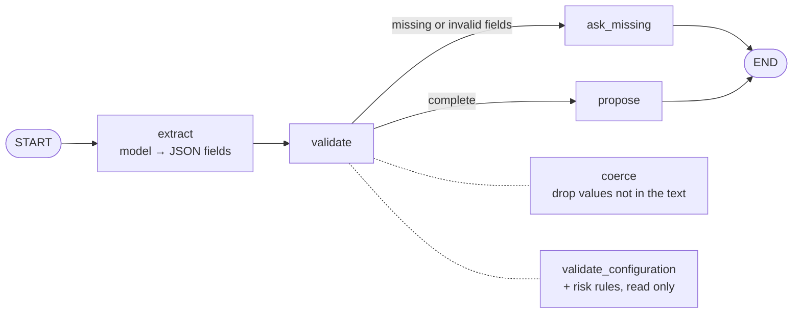

`ask_missing` and `propose` are written by code. Nothing is saved: the proposal only pre-fills the normal setup form.

### what-if (US-28)

Runs only through `POST /simulations/{id}/what-if`, i.e. after the student pressed **Run what-if** on the chat proposal.

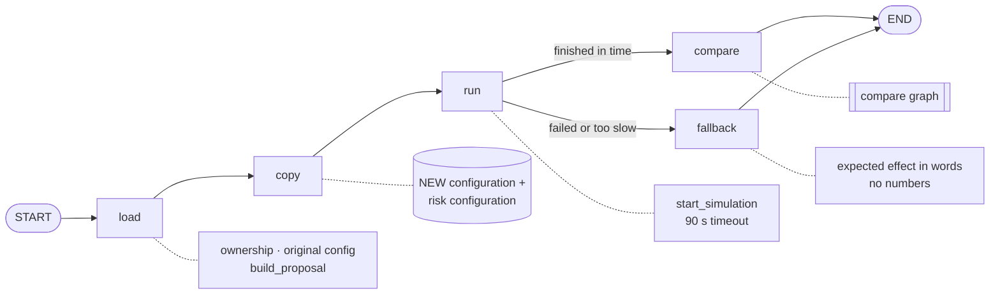

The original configuration, risk configuration and simulation are never updated. If the compare agent is unavailable, the computed comparison is returned without its explanation.

### knowledge (US-30)

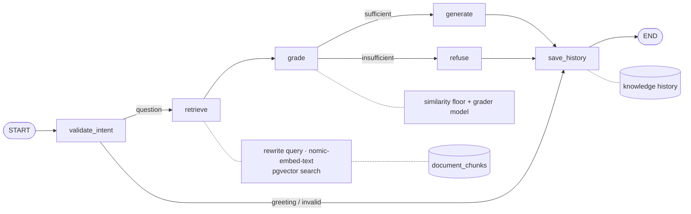

`generate` answers only from the retrieved passages and cites them; `refuse` returns a fixed text.

---

## 3. Shared guarantees

- **Own data only.** Every tool and service checks that the simulation or configuration belongs to the student (`user_id`); otherwise it is a 404.
- **Code computes, the model only writes.** Numbers, dates, differences and selections come from Python; the model turns them into plain language.
- **Verification.** `verify` rejects any number or date that is not in the facts (`agents/insights/verify.py`), comparisons the wrong way round (compare) and promises about future results; the model gets one retry, then the text is dropped.
- **Human in the loop.** Nothing is run or saved by an agent on its own: the what-if runs only after **Run what-if**, and a described setup only pre-fills the form the student then confirms.
- **Conversation memory.** Postgres checkpointer for the chat thread plus retrieval of the earlier turns relevant to the new question.
- **Graceful degradation.** If Ollama is down or slow the endpoint returns 503 with a clear message and the rest of the page keeps working.

---

## 4. How to regenerate

From `backend/`:

```bash
python -m scripts.export_agent_graphs
```

It builds every graph with a fake model and dummy settings (no Ollama, no Supabase, network blocked) and writes `docs/agents/graphs/<name>.mmd` with `graph.get_graph(xray=True).draw_mermaid()`. Compare those files with the diagrams above after changing a graph.

### PNGs for the presentation

- Paste a diagram into <https://mermaid.live> and use **Export → PNG**, or
- `npx @mermaid-js/mermaid-cli -i docs/agents/graphs/<name>.mmd -o docs/agents/graphs/<name>.png`

The hand-drawn diagrams on this page (with tools) can be exported the same way by saving the block to a `.mmd` file first. The overview and the chat diagram are already exported for the slides:

| Overview | Chat |
|---|---|
| 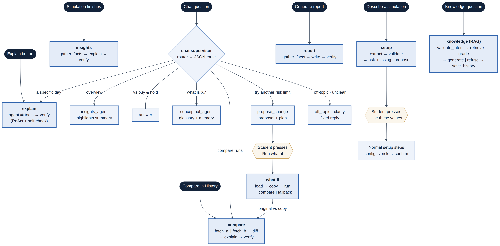 | 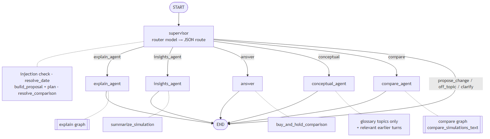 |
