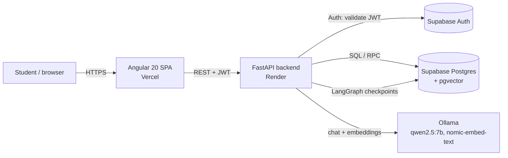
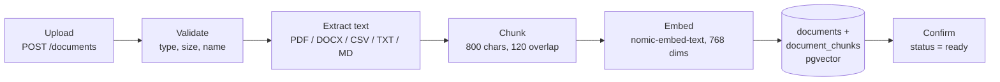

# Architecture

## 1. System overview



## 2. Backend layers

```
app/
  main.py          FastAPI app, CORS, routers
  core/            config, Supabase clients, auth dependency (get_current_user)
  modules/         one package per feature: routes -> service -> (schema)   [controllers]
  agents/          LangGraph graphs: explain, chat, insights, knowledge (RAG)
  vectorstore/     embeddings + pgvector repository
  services/        pure computation: indicators, strategies, benchmark, historical data
```

Rule of dependencies: `routes -> service -> agents / vectorstore / services -> Supabase`. Routes never touch the database directly.

## 3. Document ingestion pipeline (US-33)



A document row is created first as `processing`; any failure leaves it as `failed` with the reason, so nothing is half-indexed silently.

## 4. Knowledge agent graph (US-30, LangGraph)


### Hallucination control

| # | Strategy | Where |
|---|----------|-------|
| 1 | Minimum similarity threshold when retrieving | `retrieve` (`RETRIEVAL_THRESHOLD`) |
| 2 | Dedicated sufficiency node: similarity floor + LLM yes/no check | `grade` |
| 3 | Prompt restricted to the retrieved context | `ANSWER_SYSTEM_PROMPT` |
| 4 | Explicit refusal with a fixed text (also when the model itself reports insufficient context) | `refuse`, `generate` |
| 5 | Sources shown with every answer (file, page, snippet) | `generate` |

## 5. Simulation agents

- **explain** (US-20): tool-calling ReAct agent that explains one decision using price, indicators, risk and regime tools.
- **chat** (US-22/25): router + dedicated nodes, Postgres checkpointer, relevance-based memory.
- **insights** (US-26): event-triggered graph `gather_facts -> explain -> verify`.
