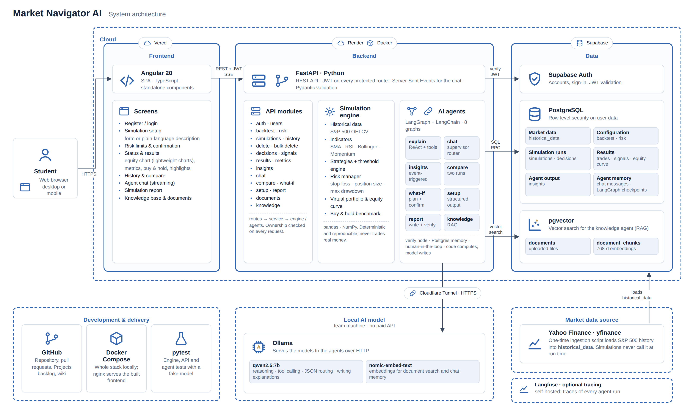
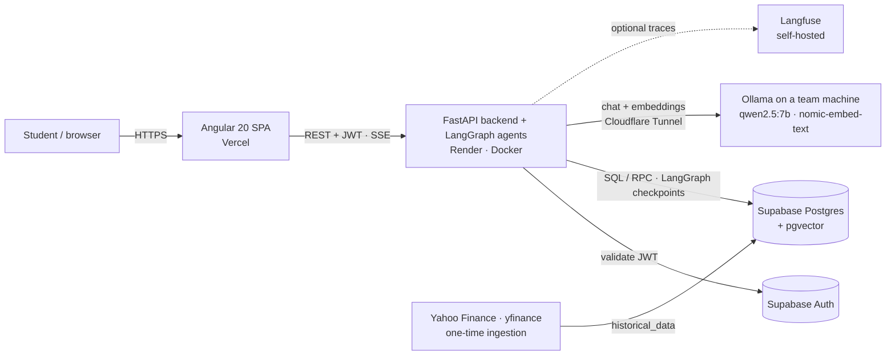
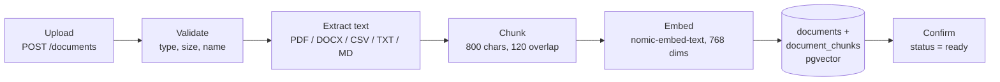
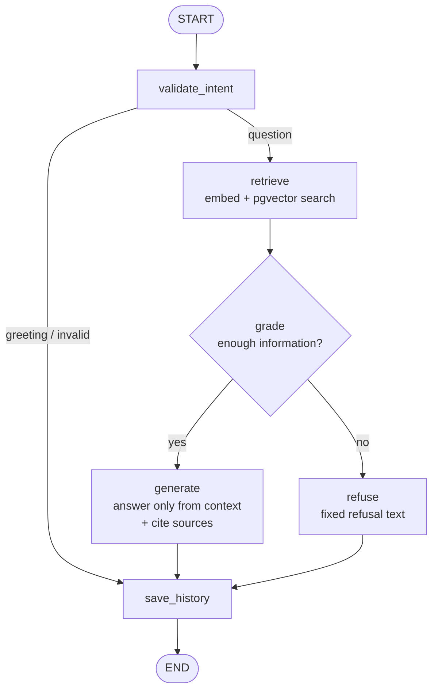
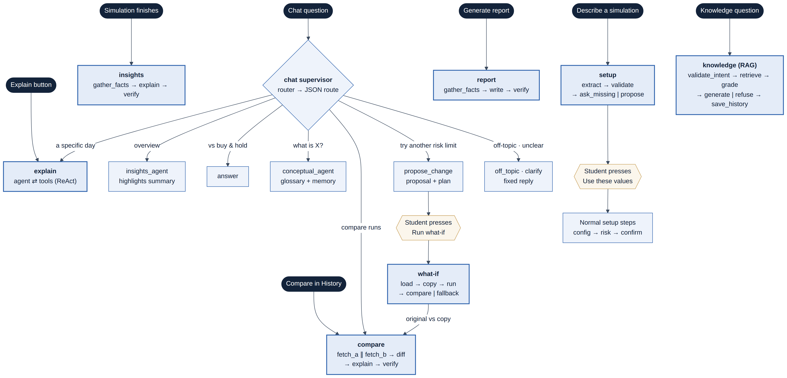

# Architecture

## 1. System overview



Editable source: [`diagrams/architecture.html`](diagrams/architecture.html) (open it in a browser; add the official logos to `diagrams/logos/` as described in its README).



## 2. Backend layers

```
app/
  main.py          FastAPI app, CORS, routers
  core/            config, Supabase clients, auth dependency (get_current_user)
  modules/         one package per feature: routes -> service -> (schema)   [controllers]
  agents/          LangGraph graphs: explain, chat, insights, compare, report, setup, what-if, knowledge (RAG)
  vectorstore/     embeddings + pgvector repository
  services/        pure computation: indicators, strategies, benchmark, historical data
```

Rule of dependencies: `routes -> service -> agents / vectorstore / services -> Supabase`. Routes never touch the database directly.

## 3. Document ingestion pipeline (US-33)



A document row is created first as `processing`; any failure leaves it as `failed` with the reason, so nothing is half-indexed silently.

## 4. Knowledge agent graph (US-30, LangGraph)



### Hallucination control

| # | Strategy | Where |
|---|----------|-------|
| 1 | Minimum similarity threshold when retrieving | `retrieve` (`RETRIEVAL_THRESHOLD`) |
| 2 | Dedicated sufficiency node: similarity floor + LLM yes/no check | `grade` |
| 3 | Prompt restricted to the retrieved context | `ANSWER_SYSTEM_PROMPT` |
| 4 | Explicit refusal with a fixed text (also when the model itself reports insufficient context) | `refuse`, `generate` |
| 5 | Sources shown with every answer (file, page, snippet) | `generate` |

## 5. Simulation agents

The 8 LangGraph graphs (explain, chat, insights, compare, report, setup, what-if and knowledge), with one diagram per agent showing its nodes, edges and the tools each node uses, are described in **[agents.md](agents.md)**.


